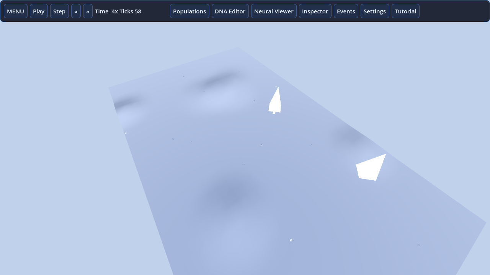

# AI Planet Remaster

A Godot 4 remaster of **ai.planet** (Artificial Planet), the GPL-2.0 ecosystem
simulator originally written in Delphi/GLScene by Dave Kerr and contributors
(2003-2005, http://aiplanet.sourceforge.net).

You are the guardian of a living planet: sculpt terrain, pour water, plant
forests and watch rabbits, foxes, birds, sharks and evolving trees live, eat,
mate and mutate generation after generation.



## What is remastered

- **Full simulation core ported** from the original Pascal (35k lines):
  cellular water (rivers and lakes emerge), weather, sun/moon/asteroids,
  48 entity kinds, heritable DNA with mutation, mating with life stages,
  boid communities, learning creatures and evolving trees.
- **Real neural network**: the original `cAINeuralNet.pas` was an empty stub -
  the remaster ships a working MLP (6-8-2) trained by reinforcement, with a
  live network viewer.
- **Modern rendering**: dynamic planet mesh, wave-shaded water, GPU-era
  particles, DNA-tinted creatures using the original 51 models (converted
  .3ds → glTF) and the original 40 sounds.
- **Modern UI**: touch-friendly HUD, population charts, DNA editor, entity
  inspector, event log, tutorial, English + Spanish.
- **Improvements**: spatial hash instead of O(n²) scans, fixed-tick
  accumulator with speed control, new compressed `.aipr` save format.
- **Classic worlds**: imports the terrain of the final-format `.air` worlds
  (920/960) shipped by the original project - 8 classic worlds included.

## License

**GPL-2.0** (see [LICENSE](LICENSE)), inherited from the original project as
required. All original code, models, textures and sounds are by their original
authors; the remaster code and generated assets are GPL-2.0 too.

Credits: ai.planet by **Dave Kerr**; DNA species data by Dushan Tcholich;
tiger by Aaron Hochwimmer; manual by Dennis Murczak. Remaster by **kroryan**
(Godot 4.7). Third-party addons (MIT): Phantom Camera, GUT, tau-plot.

## Controls

| Action | Input |
|---|---|
| Orbit / zoom camera | Right-drag, wheel, pinch |
| Select entity | Left click (Select tool) |
| Apply tool | Left click / tap |
| Play / pause / step / speed | Top bar |
| Panels | Populations, DNA, Neural, Inspector, Events, Settings, Tutorial |

## Build

Requires Godot 4.7.2 + export templates.

```
godot --headless --import .
godot --headless --path . --export-release "Linux" build/linux/AIPlanetRemaster.x86_64
godot --headless --path . --export-release "Windows Desktop" build/windows/AIPlanetRemaster.exe
godot --headless --path . --export-release "Android" build/android/AIPlanetRemaster.apk
```

The **AIP Build Manager** editor addon (right dock) does all of the above with
one click, including Android versioning, keystore staging and SHA-256 build
reports. For **Microsoft Store MSIX** and CI builds use
`.github/workflows/build-release.yml` (packs a signed-optional MSIX on a
Windows runner).

Play Store: export the **Android AAB** preset and sign with your upload
keystore (`ai-planet-upload.keystore` + `keystore.properties` in the project
root; never committed). Package id: `net.sourceforge.aiplanet.remaster`.

## Tests

```
godot --headless --path . -s addons/gut/gut_cmdln.gd -gdir=res://tests -gexit
```

## Project layout

```
core/      simulation (headless, testable) - port of Code/*.pas
render/    planet mesh, entities, effects, camera
ui/        HUD, panels, main menu, i18n (EN/ES)
scenes/    Main.tscn
assets/    original models (.glb), textures, audio (.ogg), logos
data/dna/  original species DNA ini files
worlds/    classic .air worlds (importable)
addons/    aip_build_manager (GPL-2.0) + phantom_camera/gut/tau-plot (MIT)
tools/     asset pipeline (3DS→GLB converter, icon, air validator) - dev only
```
